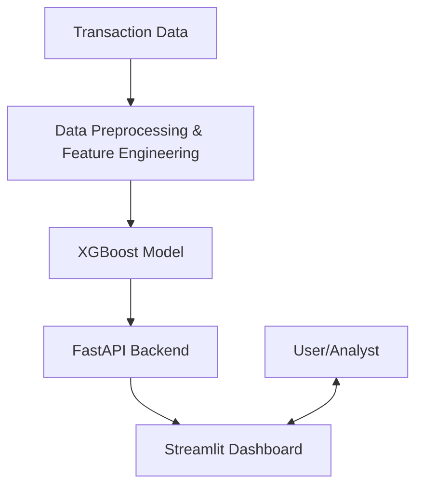

# Fintech Fraud Detection & Transaction Risk Analytics

## 📖 What is the Project About?
This project is an end-to-end Machine Learning system designed to detect potentially fraudulent financial transactions. It processes transactional data, engineers relevant features, natively handles severe class imbalances, and uses an XGBoost model to assign a probability-based risk score to each event.

## 🎯 Importance of the Project
Fraud costs the financial industry billions of dollars annually. Traditional rule-based systems generate high false-positive rates, leading to blocked legitimate transactions and poor user experiences. This ML-driven approach prioritizes PR-AUC (Precision-Recall Area Under Curve), maximizing the detection of actual fraud while maintaining a low false-positive rate.

## 👥 Who is this for?
- **Risk Analysts & Investigators:** To triage and manually review high-risk transactions efficiently.
- **Data Scientists & ML Engineers:** As a reference architecture for dealing with highly imbalanced datasets.
- **FinTech Product Teams:** To integrate real-time risk scoring directly into payment flows.

## 🏗️ Architecture


## 💻 Tech Stack
- **Core:** Python 3.11+
- **Machine Learning:** Scikit-learn, XGBoost
- **Data Processing:** Pandas, NumPy
- **Backend API:** FastAPI, Uvicorn, Pydantic
- **Frontend:** Streamlit
- **Testing & Tooling:** Pytest, Docker

## 🚀 Steps to Clone & Setup

1. **Clone the repository:**
   ```bash
   git clone https://github.com/vamshidharsingh/fintech-fraud-detection.git
   cd fintech-fraud-detection
   ```
2. **Create and activate a virtual environment:**
   ```bash
   python -m venv venv
   
   # On macOS/Linux:
   source venv/bin/activate  
   
   # On Windows:
   .\venv\Scripts\activate
   ```
3. **Install dependencies:**
   ```bash
   pip install -r requirements.txt
   ```

## 🕹️ How to Use It
1. **Generate Synthetic Data:** Run the data generator to create a realistic, imbalanced dataset.
   ```bash
   python generate_data.py
   ```
2. **Train the Model:** Run the training script to build the XGBoost classifier and save the model artifact.
   ```bash
   python train.py
   ```
3. **Start the API:** Launch the FastAPI backend.
   ```bash
   python app.py
   # Or: uvicorn app:app --port 8001
   ```
4. **Start the Dashboard:** In a new terminal, launch the user interface.
   ```bash
   streamlit run dashboard.py --server.port 8501
   ```
5. **Interact:** Open `http://localhost:8501` in your browser. Enter sample transaction details and receive instant risk evaluations.

## 🔮 Possible Improvements / Future Enhancements
- **Graph Neural Networks (GNNs):** Implementing GNNs to detect coordinated fraud rings by analyzing account relationships instead of just isolated events.
- **Streaming Inference:** Migrating the batch-prediction API to consume live transaction streams from Apache Kafka.
- **Model Drift Detection:** Adding tools like EvidentlyAI to monitor input data distributions over time to catch evolving fraud patterns.

## 📄 License
This project is licensed under the MIT License.
